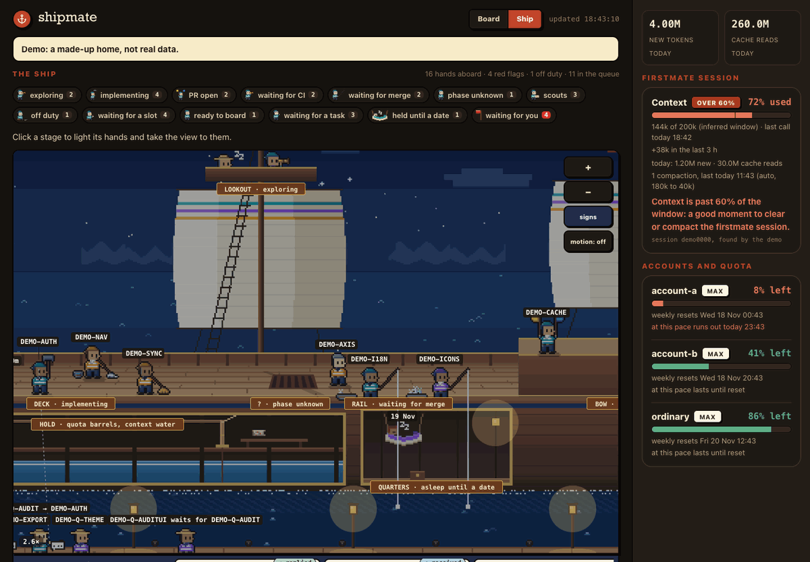
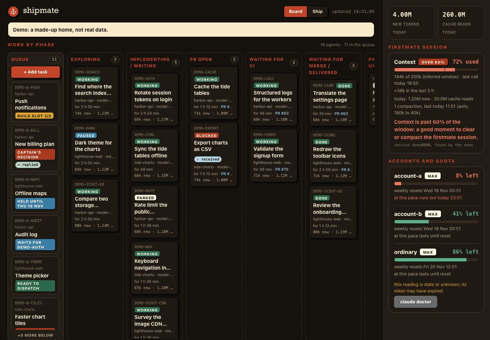
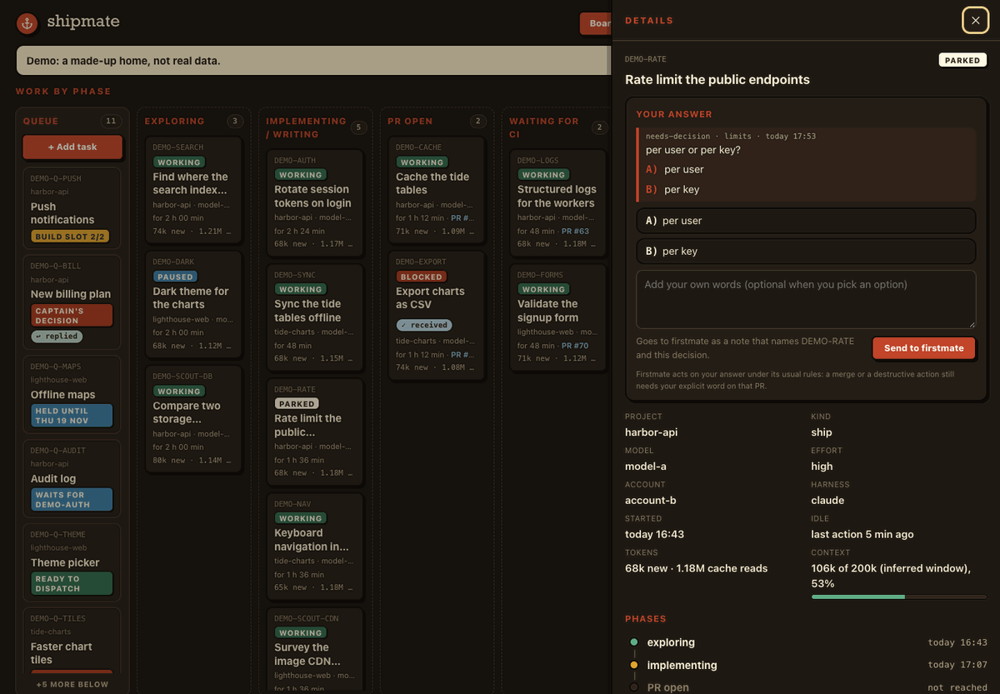
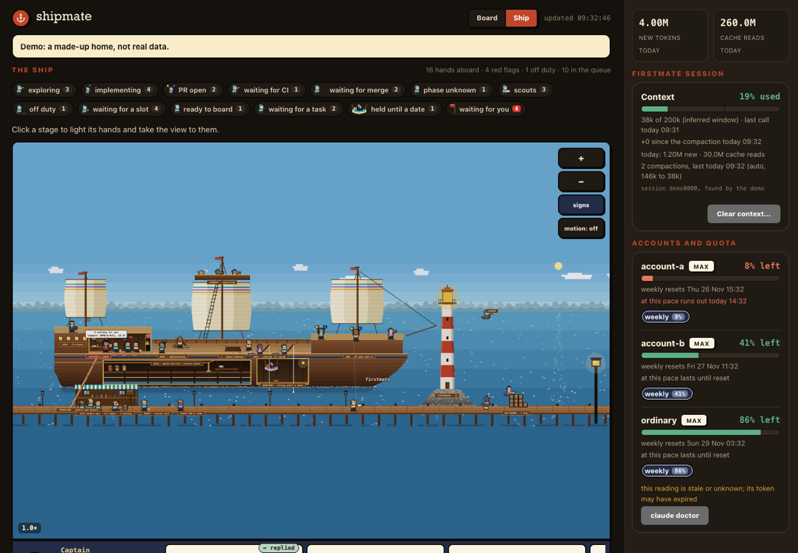

# shipmate

shipmate is a small local dashboard for a [Firstmate](https://github.com/kunchenguid/firstmate) home.
Firstmate runs a fleet of coding agents on your machine: it takes tasks from a queue, hands each one to a worker, and follows it from exploring to a merged PR.
shipmate shows that fleet at a glance, read live from the home's own records, so you can see what every agent is doing, what waits for you, and how much context and quota is left, without asking firstmate or reading its files.

It is for the person firstmate works for, the captain: one browser tab beside the terminal, refreshed every 30 seconds.
From the same page you can answer the decisions firstmate is waiting on and queue new tasks.

It is one Python file, a template, and a stylesheet: standard library only, no build step, no web fonts, no CDN.
It listens on `127.0.0.1` only.



## Run it

```bash
FM_HOME=/path/to/your/firstmate-home python3 shipmate.py
# shipmate: http://127.0.0.1:8737/
```

To look around without a Firstmate home, run the demo: a made-up home with every phase, flag and gauge in use.
Every picture in this README is the demo.

```bash
python3 shipmate.py --demo
```

Python 3.9 or newer.
The options are under [Configuration](#configuration).

### Keep it running (optional)

On macOS a LaunchAgent can keep it up.
Nothing installs one for you; to add it, save a file like this as `~/Library/LaunchAgents/local.shipmate.plist`, with your own paths, then run `launchctl load ~/Library/LaunchAgents/local.shipmate.plist`:

```xml
<?xml version="1.0" encoding="UTF-8"?>
<!DOCTYPE plist PUBLIC "-//Apple//DTD PLIST 1.0//EN" "http://www.apple.com/DTDs/PropertyList-1.0.dtd">
<plist version="1.0">
<dict>
  <key>Label</key><string>local.shipmate</string>
  <key>ProgramArguments</key>
  <array>
    <string>/usr/bin/python3</string>
    <string>/path/to/shipmate/shipmate.py</string>
    <string>--home</string><string>/path/to/your/firstmate-home</string>
  </array>
  <key>EnvironmentVariables</key>
  <dict><key>PATH</key><string>/usr/local/bin:/opt/homebrew/bin:/usr/bin:/bin</string></dict>
  <key>RunAtLoad</key><true/>
  <key>KeepAlive</key><true/>
</dict>
</plist>
```

The `PATH` must reach `tasks-axi`, `quota-axi`, `jq`, and whatever else the home's `bin/` scripts call.
`launchctl unload` with the same path stops it.
On Linux a `systemd --user` service with the same command does the same job.

## The views

The page has two views of the same snapshot, "Board" and "Ship", switched in the header; the browser remembers the choice.
A fixed sidebar on the right stays on screen with both.

### The board



- **A board by phase** fills the page: the queue is the first lane (what waits and why, with a "+ Add task" button that queues a new task and notifies firstmate), then one lane per phase of the live workers: exploring, implementing / writing, PR open, waiting for CI, waiting for merge / delivered.
  A phase with nothing in it shrinks to a thin labelled strip so the busy lanes get the width; a lane taller than the screen scrolls inside itself and says how many cards are below; when lanes are out of view the board says so.
- **The sidebar** keeps today's tokens, firstmate's own session (context against the model's window, growth, compactions, and a warning past a threshold so you know when to clear it) and every Claude account's quota (tightest first: what is left, when it resets, when it runs out at the current pace) on screen while the board scrolls; an account whose reading is stale or unknown gets a "claude doctor" button (see [Renewing an account's token](#renewing-an-accounts-token)).
  Under firstmate's session, "Clear context…" saves what only firstmate's conversation holds and then clears it (see [Clearing firstmate's context](#clearing-firstmates-context)).
- **Usage** (tokens per day and per delivered task, new tokens apart from cache re-reads) is folded under the board.

Below 1400 px of width the sidebar becomes a strip of small gauges above the board, so it never squeezes the lanes; on a phone it becomes a one-line summary that opens the full blocks, the drawer takes the whole screen, and the board scrolls sideways one lane at a time.
It looks like the Firstmate bearings board, without the board's editor around it.

### The detail drawer



A drawer opens from any card, or from any hand on the ship: facts about that piece of work, gathered from the home's records.
When the item waits on the captain, the drawer opens with the decision and a place to answer it, which reaches firstmate as an inbox note; firstmate's reply comes back to the same place.
See [The detail drawer](#the-detail-drawer) and [Answering the captain's decisions](#answering-the-captains-decisions).

### The ship



The ship view draws the same snapshot as one ship in pixel art, seen from the side and cut away.
Each agent is a hand whose place on board is its phase, and signs painted on the ship say what each place means.
Whoever waits on the captain lines up in the captain's cabin, longest wait first, and a log below the scene lists them.
The queue waits on the pier, the hold shows each account's quota and firstmate's context, and crates pile up as tasks are delivered.
Chips above the scene light one stage at a time.
It zooms and pans; the buttons in its corner zoom in and out, put the signs away, and set how much moves.
[The ship view](#the-ship-view) below says what every element stands for.

## Configuration

| Option | Environment | Default | Meaning |
| --- | --- | --- | --- |
| `--home DIR` | `FM_HOME` | none, one is required | the Firstmate home to read |
| `--fm-root DIR` | `FM_ROOT` | the home | the Firstmate code root that holds `bin/` |
| `--claude-dir DIR` (repeatable) | `SHIPMATE_CLAUDE_DIRS` (path-separator list) | none | extra Claude config directories to read transcripts from |
| `--port N` | `SHIPMATE_PORT` | `8737` | TCP port |
| `--context-limit N` | `SHIPMATE_CONTEXT_LIMIT` | inferred | firstmate's context window in tokens |
| `--context-warn P` | `SHIPMATE_CONTEXT_WARN` | `60` | warn when firstmate's context passes P percent of the window |
| `--clear-timeout N` | `SHIPMATE_CLEAR_TIMEOUT` | `900` | seconds firstmate has to stow and reply to a clear request before it lapses (at least 60) |
| `--herdr-session NAME` | `SHIPMATE_HERDR_SESSION` | `default` | the herdr session that runs firstmate, read only to find its pane |
| `--cache-seconds N` | `SHIPMATE_CACHE_SECONDS` | `5` | seconds one reading of the fleet (backlog, records, inbox receipts) answers every request; `0` reads again on each request |
| `--once` | | | print the JSON snapshot and exit |
| `--demo` | | | serve a made-up home with every phase, flag and gauge in use, instead of a real one (no `--home` needed); it changes between two moments every 30 s, so the ship's animations can be seen |
| `--lang en\|pt-BR` | `SHIPMATE_LANG` | `en` | the page's language: English, or Brazilian Portuguese with `pt-BR` |
| | `SHIPMATE_QUOTA_CMD` | `quota-axi` | quota command |
| | `SHIPMATE_GH_CMD` | `gh` | GitHub CLI used only to read a PR's checks, for the phases and the detail drawer |
| | `SHIPMATE_HERDR_CMD` | `herdr` | herdr CLI, read only to find firstmate's pane and whether it is in a turn (see [Clearing firstmate's context](#clearing-firstmates-context)) |
| | `SHIPMATE_CLAUDE_CMD` | `claude` | Claude Code CLI, run only by an account's "claude doctor" button (see [Renewing an account's token](#renewing-an-accounts-token)) |

Reloading the page, the page's own refresh and the ship view share one reading of the fleet for `--cache-seconds` seconds instead of reading it again each time.
Sending an answer or a new task drops that reading, so what comes back right after is never stale.
While a tab is hidden the page pauses every animation where it stands (it resumes from the same frame) and asks for fresh data ten times less often, then refreshes as soon as the tab is shown again.
A refresh that brings the same drawing and no change to play leaves the scene as it is, so its loops go on from where they were instead of starting over.
Switching the motion button to off in the middle of a change takes the scene straight to its final state: no figure is left on the deck and the next refresh draws as usual.
The smooth scroll to a card in the captain's log follows the button too: it is instant when motion is off, and also when the browser asks for reduced motion.

Transcripts are always read from `~/.claude` and from every directory the home lists in `config/claude-accounts`.

The language covers everything the page writes itself: labels, the board's lanes and reasons, the drawer, the sidebar, dates, and the ship view's signs, stages and log.
Text read from the home's records (task titles, status lines, hold reasons, notes) is shown as it was written.

`GET /state.json` returns the same snapshot the page is built from.
`GET /ship` returns the ship view drawn from that snapshot; with `?prev=<print>` (the `data-print` of the drawing on screen) it also lists what changed since, for the page to animate (see [Motion](#motion)).
`GET /detail?id=<task>` returns one card's drawer, `POST /answer` sends the captain's answer to a waiting decision, `POST /doctor` runs `claude doctor` for one of the home's accounts, `GET /clear` returns the drawer of "Clear context", `POST /clear` and `POST /clear/cancel` start and stop a clear request, and `GET /report?id=<task>&f=md|html` shows that task's `data/<task>/report.md` or `report.html` as a sandboxed document.

## Where each number comes from

| On the page | Source |
| --- | --- |
| Firstmate session | The session id in the home's `state/.lock-session` (written by `bin/fm-lock.sh` for the session that holds the firstmate lock), looked up in the Claude project folder of `FM_HOME` in every Claude directory read; without a usable id, the newest session in that folder, and the page says so. Context is input plus cache writes plus cache reads of the last model call. Growth compares it with the last call before the past 3 hours, or with the size right after a compaction when one happened since. Today's tokens include that session's subagents. Compactions are the transcript's `compact_boundary` records, with their trigger and the size before and after. |
| Account bars | `quota-axi --provider claude --full --json --no-credential-refresh`, with `QUOTA_AXI_CLAUDE_PROFILES` set to the non-`ordinary` entries of `config/claude-accounts`, cached 60 s. The bar is the `all_models` effective remaining percentage; the reset is the limiting window's; the projection is quota-axi's runway. Account e-mail and identity are never shown; an account is named by its config directory. |
| Agent rows | `state/<id>.meta` (project, model, effort, account, worktree, spawn time; the account also colours a hand's neckerchief in the ship view), `state/<id>.status`, `bin/fm-crew-state.sh <id>` (cached 20 s), task titles from `bin/fm-tasks-axi.sh list`. |
| Agent tokens | The worker's Claude Code transcripts in the worktree's project folder, plus their subagent transcripts. Only messages after the task's spawn count, because a pooled worktree's folder also holds earlier tasks' sessions. Each message counts once (one message is written as several lines). |
| Queue | `bin/fm-tasks-axi.sh list` (held, hold date, blocked-by) and `config/project-capacity` with the live task records that hold a place. |
| Home lanes | `bin/fm-capacity.sh` (its first `capacity:` line), read at most every 20 s and only when the home has a `config/lane-capacity`; without that file the script sets no target and shipmate does not run it. A queued task nothing else holds waits for a lane (`home lanes n/n`) when it reports no free lane. |
| How long a queued task has waited for the captain | The `Captain hold set:` time that `bin/fm-captain-hold.sh` writes first in a held task's body, read with `bin/fm-tasks-axi.sh list --state queued --fields held,body` only while some queued task is held; without that line, the day the task was created. |
| How long a hand has waited for the captain | Its oldest `needs-decision` or `blocked` status line still open; a hand flagged by its crew state alone waits since its last transcript activity. |
| The captain's answers and what became of them | `bin/fm-inbox.sh receipts --all-pending --all-handled`, cached 10 s and read again right after an answer is sent: the notes whose request id starts with `shipmate-answer:`, whether firstmate was woken, whether it took the note from its inbox, and its reply. Every note is read, so an answer's state never drops out of a bounded page while its decision is open. |
| Machine load | `os.getloadavg()` and the CPU count, read with every snapshot; only the ship view's sea uses it. |
| Per day | Every transcript under the Claude directories, by local day, each message once. `workers` are sessions launched from a Firstmate brief, `firstmate` is the home's own folder, `validation` is no-mistakes, `other` is the rest. |
| Per delivered task | The home's session sheets (`data/fichas/fichas.jsonl`), with the new/cache split recomputed from each sheet's session transcript and its subagents. |

New tokens are input plus cache writes plus output; cache reads are shown apart.

## The context window

Claude Code transcripts do not record the model's context window, so shipmate cannot read it.
Set `--context-limit` (or `SHIPMATE_CONTEXT_LIMIT`) to the real one.
Without it, the window is inferred and labelled `inferred`: 1M when the model id carries `[1m]` or when the session has already held more than 200k tokens (in a call or before a compaction), otherwise 200k.
A 1M session that has never gone past 200k therefore shows against 200k until you set the limit, which overstates how full it is rather than understating it.

## Phases

A phase is derived from recorded milestones, never from what the agent wrote in prose.
When the evidence cannot tell, the page says `unknown`.

| Ship phase | Evidence |
| --- | --- |
| exploring | a session transcript exists, with no edit inside the worktree yet |
| implementing | first `Edit`/`Write` on a file inside the worktree, or a `git commit` |
| PR open | `pr=` in the task record, a PR URL in a status line, or a `gh pr create` result |
| waiting for CI | PR open, the worker is working or paused, and its latest activity since its last edit is a CI read (`gh pr checks`, `gh run watch/view/list`) |
| waiting for merge | PR open and current state `done` |

Once a GitHub PR's checks are read (see the drawer's table below), they decide between the last phases, since a worker often reports `done` as it opens the PR, before CI has said anything:

| The PR's checks | Phase |
| --- | --- |
| one is still running | waiting for CI, even when the worker reported `done`; it started when the earliest check started |
| one failed | implementing, on the board too: the PR goes back to the work; it started when the last check finished |
| all passed, and the worker reported `done` | waiting for merge, since the last check finished or the worker reported `done`, whichever came later |
| all passed, and the worker is still at work | PR open |

Without checks, without an answer from GitHub, for a PR elsewhere, or before the first reading, the milestones above stand.

A scout goes exploring, writing the report (`data/<id>/report.md` exists), report delivered (`done`).
The bar under each agent shows the phases completed; hover `why?` for the evidence used.

## The detail drawer

Clicking a card (or Enter on a focused card) opens a drawer; Escape or the close button shuts it.
Apart from the answer form described below, everything in it is read-only and comes from records, never from transcript text:

| In the drawer | Source |
| --- | --- |
| Title and the captain's intent | the backlog title, and the `Captain's intent` section of `data/<task>/brief.md` |
| Phase timeline with the time of each milestone | the same evidence as the card's phase: spawn time, first edit or commit in the worktree, PR URL, first CI read, `done` |
| Latest status lines | the last 8 lines of `state/<task>.status`, newest first |
| PR with its state and checks | `gh pr view <url> --json state,isDraft,statusCheckRollup`, read when a drawer opens, and in the background for every ship agent with its PR open, at most every 120 s per PR in all (GitHub PRs only); a page never waits for that background read |
| Project, model, effort, account, harness | `state/<task>.meta` |
| Tokens, and the worker's context against its window | the task's transcripts, as on the card; the window is inferred like firstmate's |
| How long it has been idle | the time since the newest record in the task's transcripts |
| Report link | `data/<task>/report.md` or `report.html` when present |

A queue card's drawer shows the item from `bin/fm-tasks-axi.sh show <task> --full`: why it waits, its dependencies and its notes.

## The ship view

The ship view is drawn from the snapshot the board uses.
Each element stands for one thing:

| In the picture | What it is |
| --- | --- |
| The ship | the home; firstmate stands at the helm on the stern castle |
| A hand in the crow's nest with a spyglass | an agent exploring |
| A hand on deck with a hammer, a mop or a broom | an agent implementing; the tools take turns by when each hand reached the deck (see [Work on deck](#work-on-deck)) |
| A hand at the bow with signal flags | an agent with a PR open |
| A hand at the bow with a spyglass on the lighthouse | an agent waiting for CI; these stand ahead of the signal flags, nearest the lighthouse |
| The lighthouse on a rock in the sea, ahead of the bow | CI: its lamp blinks yellow while any hand waits for CI, and is dark when none does; it flashes green or red for about four seconds when a hand's checks come back (see [Motion](#motion)) |
| A hand fishing at the rail | an agent waiting for the merge: every check on its PR passed and it reported `done` |
| A bucket beside a hand at the rail | how long it has waited for the merge: one fish when it got there and one more each hour, up to four; its title gives the exact wait |
| The gangplank, from the stern down to the pier | the way ashore and aboard, always out: a merged hand goes down it with its crate, and a queued task comes up it when firstmate dispatches it. Nobody waits on it |
| A hand under a question mark | an agent whose phase is unknown |
| A badge on a card in the log | the captain's answer to the decision open now: sent, not woken, received or replied (see below) |
| A hand sitting with the dice | off duty: an unflagged agent exploring, implementing, signalling at the bow or of unknown phase whose crew state is `paused`, or that has had no transcript activity for 20 minutes without a busy session |
| A hand's shirt | its project's colour, in the order of `data/projects.md` (the bandana is a darker shade of it); the sails carry one stripe per project aboard |
| A hand's neckerchief | its Claude account's colour, in the order of `config/claude-accounts` (an account a worker reports that the list lacks comes after); "Accounts aboard" below the scene names them. A queued hand has no account yet, so its neckerchief is a dark shade of its shirt |
| A hand's hat | its state: a bandana at work, a straw hat when not working (off duty, or queued on the pier), bare-headed when it waits on the captain, a grey wool cap when its phase is unknown |
| A red flag over a hand | it needs the captain: the crew state is parked, blocked or failed, or a `needs-decision` or `blocked` status line has no `resolved` line with its key yet |
| The captain's cabin, in the stern castle | the captain's line: a flagged hand leaves its place and waits here, facing the desk, numbered by how long it has waited, the longest nearest the desk; a scout waits here with its map, and a queued task held for the captain's decision stands here with its sea bag at its feet (it is not aboard yet) |
| A crowd in the cabin door, with `+N` over it | the rest of the captain's line, when the cabin is full; clicking it (or Enter on it) brings their cards in the log into view, marks them and focuses the first, and one more click opens any of them |
| The captain | at the desk with a paper and a balloon saying how many wait and who has waited longest; sitting with a mug when nobody waits |
| A skiff on the horizon, rowing back with the map, moored at the pier | a scout exploring, writing the report, report delivered |
| Barrels in the hold | one per Claude account: the amber level is the quota left; red when it runs out before it resets or has less than 15% left |
| Water in the hold | firstmate's context; the white line is the warning threshold |
| The pump on the orlop | it works when firstmate's context is compacted, and the water goes down (see [Motion](#motion)) |
| Hammocks in the quarters, cut open in the hull forward of the hold | queued tasks held until a date, one asleep in each hammock under a blanket in its project's colour, the date over it (see below) |
| Hands on the pier | the rest of the queue, one hand per queued task in its project's colour, doing what says why it waits (see below) |
| Signs painted on the ship | what each place means (lookout, deck, bow, rail, gangplank, hold, quarters, helm, cabin, on its rock the lighthouse, and on the pier the slot each tavern waits for, ready, waiting for a task); the "signs" button puts them away at every zoom, and the browser remembers it |
| Crates on the pier | tasks firstmate closed as done in the last 7 days: the backlog's `closed` date, read with the rest of the backlog (`bin/fm-tasks-axi.sh list`), so a task pruned from the backlog leaves the pile. The session sheets are written later and in batches, so they feed only the usage block |
| The bell on the mizzen mast | it rings when a task is delivered (see [Motion](#motion)) |
| Day or night | the local hour: the lamps are lit from 18:00 to 06:00 (on the ship, along the pier and in the tavern's windows); the sky darkens in six steps, one every ten minutes, from 17:30 to 18:30, and lightens the same way from 05:30 to 06:30 |
| Calm, choppy or rough sea | the machine's one-minute load per CPU: under 0.6, under 1.0, above; the little waves are as many as the sea says |
| The tavern's awning | the build slot its hands wait for: striped in that project's colour, or navy with an anchor for the home's lanes |
| The key board on the tavern's wall | one hook per place the tavern waits for (the project's build slots, or the home's lanes); each key is out with the task that holds that place. Pointing at it, or focusing it, lights the hands that hold the keys (or the crowd at the cabin door one is in) and the hands that wait for them, and its title names them |
| Clouds, gulls, little waves, foam at the hull, the hull's reflection, the sun's or the moon's glitter on the sea, twinkling stars, lamp posts along the pier | nothing: the scenery says nothing about the work (see [Scenery](#scenery)) |

The scene is larger than its frame and grows with the crew so no hand stands on another.
The cabin is the exception: it has one size, so the ship never grows with the captain's line.
Three wait inside, 20 art pixels apart between the desk and the door; a fourth would need a longer stern castle, since a hand with a fishing rod or signal flags is up to 26 pixels wide.
When wide props leave no room for the third, two wait inside, and the line keeps its order: everyone after the first who does not fit is in the crowd at the door.
It opens framed on the deck and its crew; the wheel or a pinch zooms, dragging moves, a double click zooms in there, and the + and − buttons zoom in and out around the middle (zoomed all the way out, the whole scene fits).
The view stays where it is taken across refreshes until the page is reloaded.
Names show from a readable zoom up, never overlap, and come back on hover or focus when zoomed out.
Clicking a hand, on board, in the cabin, in a hammock or on the pier, opens the same drawer as its card.
The chips above the scene name each stage, say where its hands stand and who is in it now, and count them; clicking one lights those hands, fades the rest and takes the view to them, and clicking it again lets go.
The log below the scene is the captain's line as cards, longest wait first, with why each one waits and for how long; pointing at a card lights its hand (or the crowd at the cabin door it is in), and clicking it opens its drawer.
The sky, the sea and the pier reach both edges of the view, however wide the window, and whoever walks on or off the pier does it at those edges.
The sky, the ship and the near layer move at different speeds as you pan; the ship bobs, red flags blink, the tools on deck and the flags move, and lamps flicker, all only while the motion switch says "all" (see below).

### Scenery

Around the ship the harbour lives on its own, and none of it stands for anything:

| What | How it moves |
| --- | --- |
| Clouds | two layers cross the whole sky and come round again, one art pixel a step: the far one small and slow, the near one larger and quicker |
| Gulls | by day only, a gull crosses the sky now and then: two of them, on rounds of 60 and 97 seconds, each in flight for the first 40% of its round and out of sight the rest, so they rarely cross together |
| Little waves | they rise, roll a pixel or two and sink, in three sets a beat apart |
| Foam at the hull, the hull's reflection, the glitter under the sun or the moon | two frames that take turns |
| Stars | at night a few brighter ones dip now and then, on two beats |
| Lamp posts along the pier | dark by day; at night lit, with a pool of light on the planks and their reflection in the water between the piles. They keep clear of the tavern (it has its own lantern), the foot of the gangplank, the lighthouse's rock, and the moored skiffs and crates |

All of it moves only while the motion switch says "all", stands with "changes only" or "off" (the gulls are then gone and the clouds stand), and stops where it is in a hidden tab.
A loop longer than the page's refresh (a cloud's crossing, a gull's round) starts where the local clock says, so a new drawing goes on where the last one was instead of starting it over.
Things move a step at a time and never slide, so the scene is not redrawn every frame (see the cost below).

### Work on deck

Every hand implementing works on deck with a tool: the first to reach the deck hammers, the second mops, the third sweeps, and so on around again.
The order is when each one reached the implementing phase (its `phase_since`), then its id, so a hand keeps its tool from one refresh to the next; it changes only when a hand that came earlier leaves the deck, and then in the same refresh as that departure.
The tool says nothing about the work itself; it tells the hands apart.

Each tool has two frames, the raised hammer and the blow that throws chips, the mop and its stroke that leaves the deck wet, the broom and its sweep that raises dust, and how often they alternate follows the worker's transcript:

| Pace | When |
| --- | --- |
| a stroke every beat | the transcript moved in the last 2 minutes |
| a stroke in three | quiet for longer; after 20 minutes without a busy session it is off duty and sits down |
| none, the first frame only | it reported `done` or is `paused` |

The two frames swap by visibility in the stylesheet, which both take in the same style pass, so they never show together; with the motion switch on "changes only" or "off", the first frame stays.

### Motion

When the scene changes between two refreshes, the change plays once on the new drawing, and every animation stands for something that happened:

| What plays | When |
| --- | --- |
| A hand walks from its old place to its new one: down the ladder from the crow's nest, along the deck, up to the forecastle or along it | its place changed: a new phase |
| It waves its red flag three times, then walks into the captain's cabin | a `needs-decision` or `blocked` line opened, or its crew state became parked, blocked or failed |
| A green mark over its head, then it walks out of the cabin back to its place | the decision was resolved |
| A queued hand walks from the pier up the gangplank, swaps the straw hat for the bandana as it steps aboard, and goes to its place; one held for the captain walks out of the cabin | firstmate dispatched the task: its id left the queue and is a live agent |
| The lighthouse flashes green while the hand at the bow keeps its spyglass on it a moment longer, then the hand walks to the rail, where the rod bends and its first fish goes into the bucket | every check on its PR passed and it reported `done` |
| The lighthouse flashes red while the hand keeps its spyglass on it, then it walks back to the deck | a check on its PR failed |
| The rod bends, a fish comes up and goes into the bucket | a hand at the rail has waited one more hour for the merge |
| The pump works six strokes, water spouts out of the stern, and the water drops from the old level to the new | firstmate's last compaction is newer than the previous reading's |
| The lamps light one at a time, from the stern | night fell since the previous reading |
| A new hand walks in from the near end of the pier to its seat in the tavern, in its straw hat | a task joined the queue to wait for a build slot or a lane: it was neither queued, aboard nor in a skiff in the earlier reading |
| The bell rings; the hand walks down the gangplank with a crate in its arms, from wherever it stood (a task without a PR leaves from the deck, through the cabin), along the pier to the pile of delivered crates, sets the crate on it, waves and walks off the end of the pier; a scout steps from its skiff onto the pier with its crate | the agent is gone and firstmate closed its task as done (its crate is on the pile now) |
| The hand walks down the gangplank empty-handed, without the bell, and off the near end of the pier | the agent is gone and its task was not closed as done |
| The card player gets up as the bell rings and waits at the foot of the gangplank; the one leaving comes down with its crate, the two nod, and each goes on: one to the pile, the other up the gangplank to its place | in the same reading, a hand that held a build slot left and a task that waited for that slot was dispatched |

The page sends the print of the drawing on screen (`data-print`: where each hand and each scout stood and the colours to draw it again once gone, where each queued task waited and who held the build slot it waited for, the delivered crates, each hand's checks and the fish in each bucket, firstmate's context and last compaction, and whether the lamps were lit) with its request for the next one, and `ship_events` compares the two.
Nothing plays when the page has just opened, when the earlier print is more than 90 s old (a tab left in the background, or the board shown meanwhile), or for a change no reading saw happen: a hand that appears aboard without having been queued, a scout's boat at sea.
A task that goes back to the queue does not leave the ship; a scout walks off only from its skiff moored at the pier.
The slot is handed over only when the one leaving held it: like firstmate, shipmate counts as the slot's holder a task with no recorded PR, so a hand that opened a PR gave its slot up when it went to the bow, and its departure plays on its own.
At most two hands leave, four walk, two arrive at the tavern, the lighthouse flashes one answer and three fish come up after one refresh; the rest of that refresh's changes just show in their new places.
Each kind has one detector in `shipmate.py` (`EVENT_DETECTORS`) and one player in the page script (`PLAYERS`), so a new animation is added in those two places.
The frames it needs (a stride, two holds on the ladder, the spyglass held on the lighthouse, the arm with the flag, the bent rod, the catch, the jet, the crate carried and the bell's ring) are drawn by `hand_sprite` and the server like every other sprite, and arrive with the change; a hand that has left is drawn from the colours its last print kept.

The "motion" button in the scene's corner cycles through:

| Setting | What moves |
| --- | --- |
| all | the ship lives (bobbing, blinking, the tools on deck) and the changes play |
| changes only | only the changes play |
| off | nothing moves; every change shows at once in its new place |

It starts at "off" when the browser asks for reduced motion and at "all" otherwise, and the browser remembers the choice.
The drawing is the same in every setting; only the way there differs.

The cost was measured with a Chrome performance trace of the `--demo` ship view at 1440 x 900, with motion on "all" and the ship at rest (8 s away from the demo's flip and the page's refresh), on one Apple Silicon Mac, 14 Nov 2026: the busy time of the page's renderer main thread, its compositor, the GPU process and the viz compositor, per second and per frame drawn.

| Three runs each | Frames drawn per second | All four, per second | All four, per frame |
| --- | --- | --- | --- |
| Before (main `4d86797`), framed on the crew | 60 | 227 to 246 ms | 3.8 to 4.1 ms |
| Before, fitting the whole scene | 60 | 229 to 268 ms | 3.8 to 4.5 ms |
| Before, framed on the crew, with only the clouds' drift paused | 10.8 to 11.3 | 76 to 84 ms | 7.0 to 7.7 ms |
| After (the scenery and the tavern), framed on the crew | 19 to 28 | 126 to 153 ms | 5.6 to 6.5 ms |
| After, fitting the whole scene | 19 to 31 | 101 to 148 ms | 4.6 to 5.5 ms |

The clouds used to slide back and forth, and whenever some sky was in view that alone redrew the scene every frame; they now step a pixel at a time, and the whole scenery, gulls included, costs less than that drift did.
The spread after depends on whether a gull is crossing: its flight is the one loop that steps many times a second.
While changes play, the walkers redraw at most 30 times a second, and the extra work stops when the last one arrives; a refresh that comes meanwhile waits for them before it draws.

### The queue on the pier and below deck

Every queued task that is not held for the captain's decision (those wait in the captain's cabin) is a hand on the pier, or asleep below deck when it is held until a date, and what it does there is decided by the first reason the queue gives for it, nothing else:

| Where, doing what | Reason in the queue |
| --- | --- |
| Playing cards at a table at the tavern, at the foot of the gangplank, to its right (three to a table: one each side, one standing behind) | waits for a build slot (`config/project-capacity`) or a home lane (`bin/fm-capacity.sh`), and was created today |
| Drinking from a mug on the tavern bench, by the keg | the same wait, created on an earlier day: it has waited longer |
| Standing at the foot of the gangplank with a sea bag | nothing holds it: firstmate can dispatch it |
| Standing under a hand aboard, talking up to it, with a balloon and a dotted line to that hand | it waits for that task (`blocked-by`), and that task is aboard; it stands as close below it as the others allow |
| Standing apart, its tag naming what it waits for | it waits for a task that is not aboard (still queued, or gone) |
| Asleep in a hammock in the quarters below deck, its date over it | held until a date that has not come (`hold_until`) |

Each tavern has its sign with the slot it waits for (`SLOT <project> · 2/2 taken · 13 waiting`, or the home's lanes), and the other groups have theirs (ready, waiting for a task, and the quarters below deck).
Each tavern is a building behind its tables: an awning striped in the colour of the project whose slot it waits for (navy with an anchor for the home's lanes), a plank wall with windows that light up at night, a shelf of bottles, and a key board with one hook per place, each key out with the task that holds it.
So whoever waits in the tavern waits for any key to come back, where a hand talking up to the ship waits for that one hand.
The building stands below the waterline, so it hides nothing of the hull.
The tavern takes four tables and one bench of eight; the rest are counted (`+N`, with their ids on hover), and so are lines past eight.
The tavern is anchored at the foot of the gangplank, on its right, and grows to the right, so a short queue adds only a short stretch and nothing is reserved west of the ship.
The tavern's names show only on hover or focus, so a full table stays readable; the others keep their names on.
The ship moves over to make room for the tavern, and the moored scouts and crates move toward the bow past the queue.
The quarters open only while a queued task is held until a date, cut in the hull forward of the hold: the hammocks hang from the beams in two tiers, the second half a hammock on so no rope crosses a sleeper, the earliest date aft.
Each hammock keeps its date over it (`16 Nov`), and its task's id shows on hover or focus.
They take twelve hammocks; the rest are counted (`+N`, with their ids on hover).
The hold gives the quarters the room it does not need for its barrels and chart table, and the forecastle grows only when that is still short; with nobody asleep the hold is as wide as before.
A hand fishing at the rail stands over the quarters, and its line hangs in front of them, down to the water.
The four stage chips for the queue (waiting for a slot, ready to board, waiting for a task, held until a date) light their hands like the others and are left out when empty.
A queued hand never takes a working pose: the cards on a table blink, a drinker lifts the mug now and then, a talker's balloon comes and goes, a hammock sways; nothing there looks like progress, and none of it moves unless the motion switch says "all".
Every hand, on board or on the pier, and every hand in a chip is painted by one function, `hand_sprite`, from the poses in `POSES` (with `POSE_HEAD`, where each pose puts the head), the hats in `HATS` and the colours in `hand_palette`, so a new art style replaces those and nothing else; a hand asleep in a hammock, which lies down, is painted by `hammock_sprite`, from the same `hand_palette`.
A hand is drawn on a grid 13 pixels wide and 21 tall at the ship's own pixel size, seen three-quarters so both eyes show; its skin stays one flat colour, so the face reads at any zoom, and its props (a spyglass, a hammer, a mop and its bucket, a broom, flags, a rod, a crate, a map, cards, a mug) make some poses wider.
The captain and firstmate at the helm are drawn on the same scale.

## Answering the captain's decisions

The drawer of an item that waits on the captain opens with "Your answer": a hand or scout with an open `needs-decision` or `blocked` line (one form per open line), one flagged by its crew state alone, or a queued task held for the captain's decision.
Each form quotes the decision, offers its ready options when the line lists them as `A) .. B) ..` (also `(a) ..` or `1) ..`), and takes words of the captain's own; an option, words, or both.
The decision is set for reading: a line that lists `(1) .. (2) ..` (or `A) .. B) ..`) shows its opening words, then one numbered item per label, then whatever follows, and every option wraps over as many lines as it needs instead of running off one long line.
Paths and ids in it (`data/X/report.html`, `ME-INVENTARIO-DECISOES`) are set in mono and break anywhere.
Nothing in the drawer is wider than the drawer, at any width: long words and unbroken paths wrap, and the Send button stays in view.
The whole text of a decision is kept, up to 1000 characters; a queued task's captain hold used to be cut at 240.
"Send to firstmate" runs, with `FM_HOME` set:

```bash
bin/fm-inbox.sh note --request-id shipmate-answer:<form id>:<task> --json -- "<note>"
```

The note, in English whatever the page's language, names the task and its title, quotes the decision with its key and time, says how to reply, and ends with the answer after an `Answer:` line.
The form id is drawn when the drawer is drawn, so sending the same form again, after a double click or a failed request, gives back the note it already made; fm-inbox keeps one note per request id.
A half-written answer keeps its words, its choice and its focus through the 30-second refresh.

Below the forms, every answer sent about the item shows what became of it, read from `bin/fm-inbox.sh receipts`:

| State | Meaning |
| --- | --- |
| sent | the note is saved and firstmate was woken (`announced`) |
| not woken | the note is saved but the wake failed (fm-inbox exit 3); "Wake firstmate" runs `bin/fm-inbox.sh announce --json <note>`, only for a note shipmate sent as an answer |
| received | firstmate took the note from its inbox (`handled/`) |
| replied | firstmate recorded its answer with `bin/fm-inbox.sh reply <note> <text>`, shown under the captain's words |

The card of a waiting item, in the board and in the ship's log, carries the state of the latest answer sent since the item began to wait, so an answer to an earlier decision never marks a new one.
shipmate only delivers the answer: firstmate acts on it under its usual rules, so a merge or a destructive action still needs the captain's explicit word on that PR.
`POST /answer` and `POST /announce` take the same guards as the add form below.

## Clearing firstmate's context

"Clear context…" under firstmate's session in the sidebar clears firstmate's own Claude session, after saving what only its conversation holds.
It opens the drawer with the context it would clear (tokens, the share of the window, the session and the herdr pane), the three steps below, and either the button that confirms it ("Save, then clear 313k") or the reasons it cannot run now.

What the button does, in order:

1. **Save.** shipmate leaves firstmate a note in its inbox, with `FM_HOME` set:

   ```bash
   bin/fm-inbox.sh note --request-id shipmate-clear:<form id> --json -- "Clear request from shipmate: ..."
   ```

   The note, in English whatever the page's language, asks firstmate to run `/stow`, which writes the decisions, open work and learnings that exist only in the conversation to the home's files.
   It then asks firstmate to reply to that note with exactly `stowed: ready to clear` and end its turn, or with `not ready: <reason>` when it must not be cleared now.
2. **Clear.** shipmate reads `bin/fm-inbox.sh receipts` every 3 seconds for that reply.
   Only `stowed: ready to clear`, recorded within `--clear-timeout` (15 minutes by default) of the request, lets it go on.
   It then waits up to 3 minutes for firstmate's pane to end its turn, reads every guard below again, checks that `state/.lock-session` and the pane still name the session that was asked to stow, and types `/clear` into the pane:

   ```bash
   bin/fm-send.sh <herdr session>:<pane> /clear
   ```

   That is the home's verified submit: it types only into an empty composer, refuses while a prompt is open, and presses Enter until the pane confirms it.
3. **Resume.** The new session starts with firstmate's session-start re-emit, which reloads the queue, the workers, the open decisions and memory from the home's records.
   shipmate takes no part in this step.

Any other reply, no reply in time, a pane that stays in its turn, or a guard that fails at the last moment ends the request with its reason, and nothing is typed.
A `/clear` that `fm-send` typed but could not confirm (exit 3) shows as unconfirmed and is never sent again: look at the pane first.
The request runs in shipmate's server, so closing the page changes nothing; it lives in memory only, so after a restart shipmate never acts on an earlier request's reply.
"Stop waiting" ends a request before `/clear`; firstmate may still finish the stow, which only saves.
Sending the same confirmation twice (a double click, a retry) is one request, since fm-inbox keeps one note per request id, and only one request runs at a time.
The sidebar shows the state of the latest request beside the button: saving, saved, clearing, cleared, unconfirmed, not cleared, timed out, failed or stopped.

Firstmate's pane is never guessed.
It is the herdr pane whose agent herdr registered with the session id in `state/.lock-session`, whose working directory is the home, and whose foreground process is the pid on line 1 of `state/.lock`.
No such pane, more than one, or another process in it refuses the request.
shipmate itself only reads herdr (`herdr agent list` and `herdr pane process-info`, in the session `--herdr-session` names); it never starts, stops or restarts anything there.

The request is refused, with the reason in the drawer, only while something lives in firstmate's conversation that a clear could lose:

| Refused while | Read from |
| --- | --- |
| firstmate's pane is in a turn | herdr's `agent_status` for the pane: `idle` or `done` is out of a turn, anything else refuses the request; when the moment to type comes after the reply, it is waited for instead |
| a captain's note waits in firstmate's inbox | `bin/fm-inbox.sh receipts`: a pending note other than this request |
| firstmate took the captain's answer and has not replied yet | `bin/fm-inbox.sh receipts`: an answer sent from shipmate that firstmate took from its inbox, with no reply, while its decision is still open |
| a merge or another guarded command is under way | a live holder of `state/.control-<task>.lock` (held by `bin/fm-merge-local.sh`, `bin/fm-pr-merge.sh` and every other control action on that task) or of `state/.afk-contract.lock` (also held by a forge merge); a holder counts while its pid is alive with the start time the lock recorded |
| firstmate's session or pane is unknown | the session lock and herdr, as above |

Open and held decisions never block: an open `needs-decision` line in `state/<task>.status` or a queued task held for the captain's decision is a record in the home, which can stay open for days and survives the clear.
The drawer lists them as information ("these stay open and survive the clear"), and the new session reloads them.

Workers are not interrupted: each runs in a session and a pane of its own, and `/clear` reaches only firstmate's.

There is nothing to undo.
`/clear` drops the conversation, not the work: the backlog, the workers' records, the open decisions, the inbox and what the stow wrote are files in the home, and the new session reads them back.
The old conversation also stays on disk as its transcript in the home's Claude project folder.

## Adding a task

"+ Add task" at the top of the queue lane opens the form in the drawer, beside where the task will appear.
The form runs, with `FM_HOME` set:

```bash
bin/fm-tasks-axi.sh add "<title>" --mint --repo <project> --queue --json [--body "<notes>"]
bin/fm-inbox.sh note --request-id shipmate-<form id> --json -- "New task queued from shipmate: <id> ..."
```

The project list comes from `data/projects.md`.
Only `POST` from `127.0.0.1` with this server's `Host`, a matching `Origin` when the browser sends one, no cross-site `Sec-Fetch-Site`, and the per-run token embedded in the page is accepted.
A resubmitted form (same hidden request id) never queues twice.

## Renewing an account's token

Claude Code signs in with a short-lived access token that it renews by itself while it runs.
An account nobody has used for a while can be left with an expired token, and quota-axi then reports its quota as stale or unknown (`credentials_expired`, with `claude doctor` as the remedy), because shipmate reads the quota with `--no-credential-refresh` and never renews a credential while reading.

When an account's reading is stale or unknown, the sidebar says so under the account and shows a "claude doctor" button.
One click runs, on the server:

```bash
CLAUDE_CONFIG_DIR=<the account's directory> claude doctor
```

`claude doctor` has Claude Code check that account, which renews its token when the session can still be renewed, and exits; it cannot bring back an account that was signed out.
For the `ordinary` account (`~/.claude`, Claude Code's default) it runs with no `CLAUDE_CONFIG_DIR` at all, since setting one would make it another account.
Right after, shipmate forgets its quota reading and reads every account again, and the button's place shows whether the run worked, for 15 minutes.

The rules it keeps:

- The request names an account only by the label the page shows; the directory is looked up in the home's `config/claude-accounts`, and a label that is not there, or that two directories share, runs nothing.
- The command is a fixed argument list run without a shell, from the account's directory, with no input and a 90-second limit, after which it is stopped with everything it started.
- Its output is discarded unread: it can name the signed-in account, so nothing of it is shown, logged or kept, only whether it exited cleanly.
- It is a `POST` with the same guards as the other forms: from `127.0.0.1` with this server's `Host`, a matching `Origin`, no cross-site `Sec-Fetch-Site`, and the page's per-run token.
- One run at a time; a second click while one runs is refused.

The demo shows the button on its `ordinary` account and runs nothing.

## Tests

```bash
./shipmate.test.sh
```

The tests build a throwaway home, fake `bin/` scripts, a fake quota command, and tiny synthetic transcripts; they never read a real home or a real transcript.
